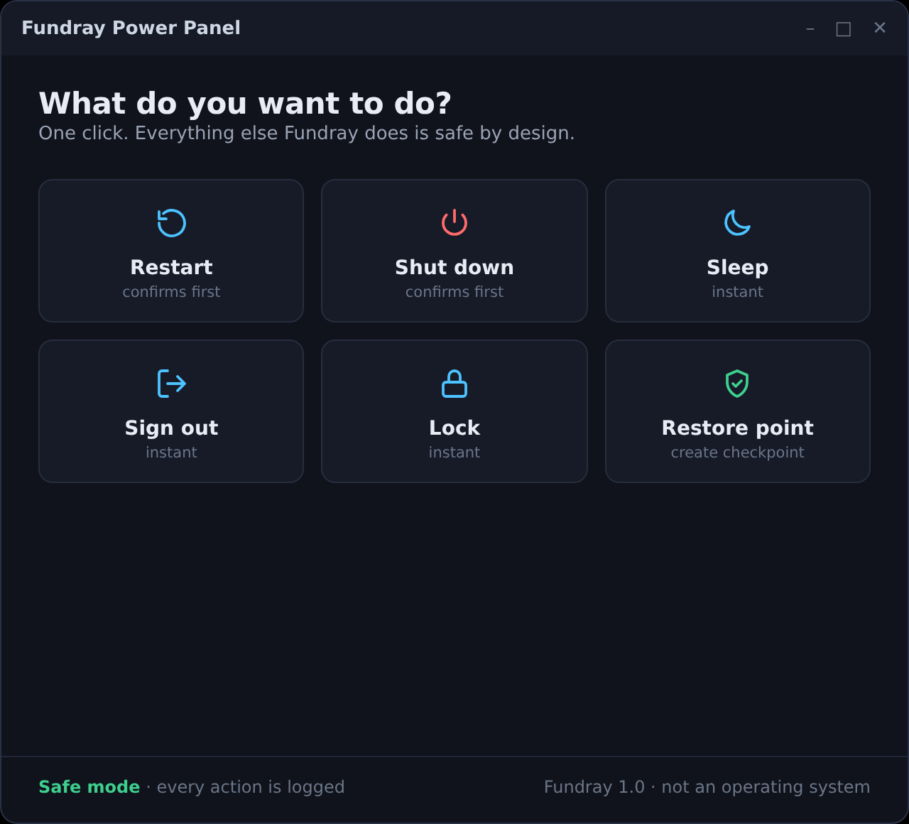

# Power Panel — the shutdown GUI

> Fundray is an enhancement toolkit, **not an operating system**. Power Panel
> is the everyday face of it: six big buttons in one dark window.



## What the buttons do

| Button | Action | Confirmation |
| --- | --- | --- |
| **Restart** | `shutdown.exe /r /t 0` | Yes |
| **Shut down** | `shutdown.exe /s /t 0` | Yes |
| **Sleep** | `rundll32.exe powrprof.dll,SetSuspendState 0,1,0` | No |
| **Sign out** | `shutdown.exe /l` | No |
| **Lock** | `rundll32.exe user32.dll,LockWorkStation` | No |
| **Restore point** | creates a System Restore checkpoint | No |

Every action is appended to `%ProgramData%\Fundray\logs\powerpanel.log`.
Press **Esc** to close the panel.

## Run it

- **Start menu → Fundray → Fundray Power Panel** (created by `install.bat`,
  option [6] or [1]), or:
- `powershell -NoProfile -ExecutionPolicy Bypass -File "%ProgramFiles%\Fundray\scripts\powerpanel.ps1"`

Tip: right-click the Start-menu entry → **Pin to taskbar** for one-click
access from anywhere.

## Requirements

- Windows 7 SP1 or Windows 10 (Windows Forms + PowerShell 2.0+)
- Administrator rights only for the **Restore point** button; the power
  actions work from a normal session

## The C# build

The toolkit also ships a compiled WinForms version in the GUI
(`src/FundrayMain.cs`). Build it with:

```bat
build.bat
install.bat   REM option [1] or [8] installs Fundray.exe + shortcuts
```

Both versions do the same job — the PowerShell one exists so the feature
works even without compiling anything.
